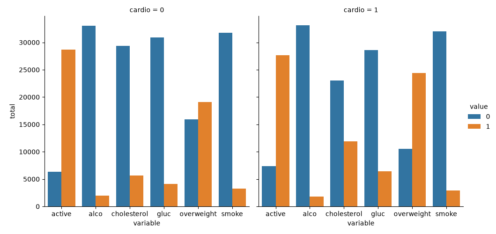
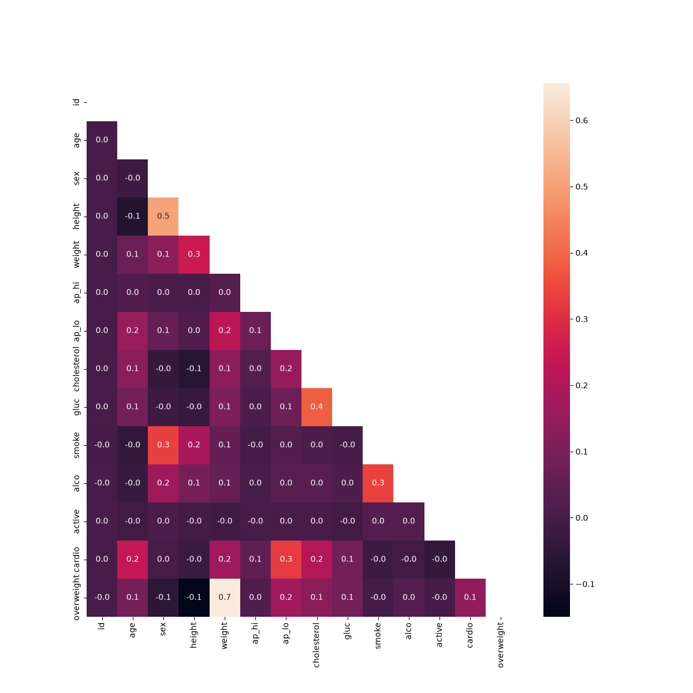

# Medical Data Visualizer

Solusi proyek freeCodeCamp *Data Analysis with Python* — Medical Data Visualizer.

## Deskripsi

Proyek ini memvisualisasikan dan menghitung data pemeriksaan medis menggunakan **Pandas**, **Matplotlib**, dan **Seaborn**. Dataset berisi informasi seperti pengukuran tubuh, hasil tes darah, dan gaya hidup untuk mengeksplorasi hubungan antara penyakit kardiovaskular dan berbagai faktor.

## Fitur & Tugas

1. **Data Preprocessing:** Menambahkan kolom `overweight` berdasarkan perhitungan BMI (Body Mass Index).
2. **Normalisasi:** Mengubah nilai `cholesterol` dan `gluc` menjadi biner (0 untuk normal, 1 untuk di atas normal).
3. **Categorical Plot:** Memvisualisasikan jumlah hasil baik/buruk untuk fitur kesehatan pada pasien dengan dan tanpa penyakit jantung.
4. **Heatmap Korelasi:** Memvisualisasikan matriks korelasi antar variabel medis setelah membersihkan data outlier.

## Hasil Visualisasi

### 1. Categorical Plot


### 2. Correlation Heatmap


## Struktur Project

| File | Keterangan |
|------|-----------|
| `medical_data_visualizer.py` | Kode utama (preprocessing & visualisasi) |
| `main.py` | Entry point untuk menjalankan pembuatan grafik dan unit test |
| `test_module.py` | Unit test dari freeCodeCamp |
| `medical_examination.csv` | Dataset medis |
| `requirements.txt` | Dependensi (`pandas`, `seaborn`, `matplotlib`) |

## Cara Menjalankan

```bash
# Install dependensi
pip install -r requirements.txt

# Jalankan program
python main.py
```

## Hasil Test

```text
Ran 4 tests in 4.192s

OK
```
